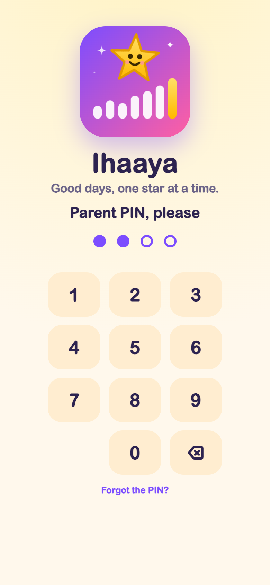
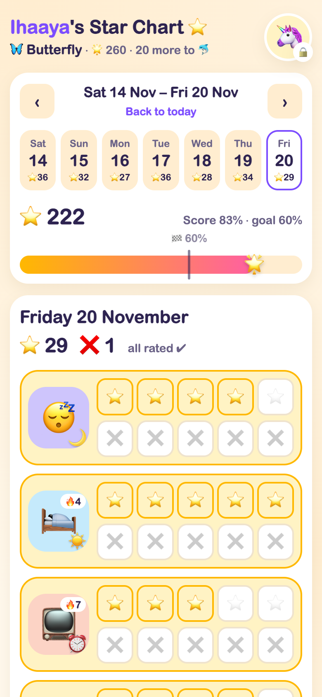
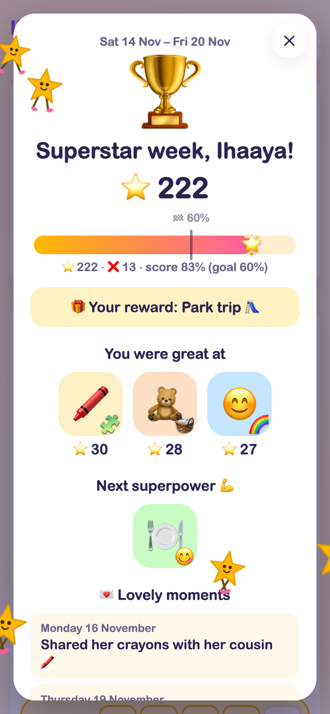
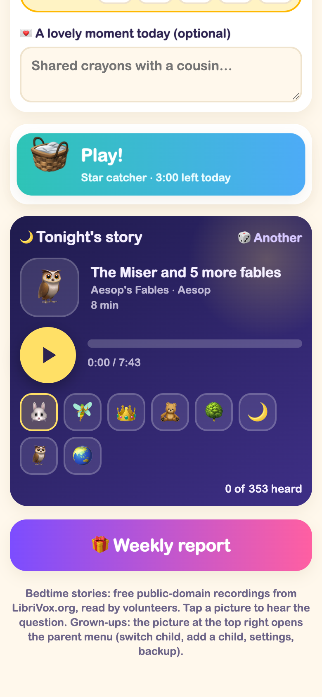

# Ihaaya

*Shine a little brighter every day.*

🔗 **Open the app: [ankitkatiyar567.github.io/ihaaya](https://ankitkatiyar567.github.io/ihaaya/)**

  
  
  
  

Logo and parent PIN · the day's pictures with ⭐ / ❌ · a winning Friday report · the day's game and tonight's story (demo data)

A picture star chart for young children. Every evening she rates her own day: 1 to 5 stars, or 1 to 5 crosses, for each picture. Tap a picture to hear the question. Grown-ups tap + each time she cries. Stars add, crosses take away and every cry takes two stars away (a day never goes below 0); the score is the stars left out of the most possible, 5 per rated picture. Five short pointers show the basics the first time; ❓ at the top opens a quick help sheet with the tour and the full [help page](https://ankitkatiyar567.github.io/ihaaya/help.html), which the PIN screen also links to. On Friday evening the weekly report shows running stars when the week's score reaches the goal (60%, about 3 stars a picture), and a gentle "not this time" with what to practise when it doesn't.

🇬🇧 🇫🇮 English or Finnish: the switch on the PIN screen (and in Settings) changes every word in the app and on the help page, the questions read aloud and the voice. Pictures you renamed keep your words. The questions use the phone's own voice; the app picks its most natural one (an Enhanced or Premium voice, if installed).

The app opens on a logo screen that asks for the 4-digit parent PIN (the first time, you choose it). With more than one child it then asks who is rating today. After 5 minutes in the background it locks again. Use it as a phone app: iPhone Safari → Share → Add to Home Screen; Android Chrome → ⋮ → Install app. It opens full screen in portrait and works without internet (sw.js keeps a copy, network first).

🎮 Daily game: when every picture is rated and the day reaches the goal, the day's game opens for 3 minutes (2, 3 or 5 in Settings), for that day only. Six games: 🎈 balloon pop, 🃏 memory match, 🧺 star catcher, 🐹 peek-a-boo, 🔢 counting and ⭕ tic-tac-toe with a kind Teddy. Each child gets one a day in a shuffled order (every game once in six days, never twice in a row). She can stop and come back; the time adds up, and her best score is kept per game.

🌙 Bedtime story: every day one complete 7–10 minute story, picked at random and never one already heard (353 stories, about a year before any comes back). Tap a theme picture for a story about animals, fairies, princes and princesses, toys, nature, the moon and stars, fables or faraway lands, or 🎲 for another. Free public-domain recordings from LibriVox.org, read by volunteers and played from the Internet Archive. Only authors who died before 1956 (free in the EU too), gentle tales only (Andersen and the original Grimm limited to a gentle list), every file checked: `tools/build-stories.py` rebuilds `stories.json`. In Finnish the stories are Finnish too, still read by real people and for children only: 43 stories (`tools/build-stories-fi.py` → `stories-fi.json`), four Andersen tales from LibriVox plus hand-picked gentle episodes of four free Finnish children's podcasts (Hippo-satuja lapsille by OP Pohjola, Kauneimmat lastensadut by HÖÖD, Iltasatu lapselle, Satuhetki), streamed from each podcast's own feed and credited under the title; no audio is copied into this repository.

Each child has a profile with their own pictures, goal, reward, stars and Friday report. A new install asks for the first child's name and picture (no name is built in). In the parent menu, ✏️ next to a child edits the name and picture and 🗑️ removes the child; removing the only child asks for a new one. Grown-ups tap the child's picture at the top right to open the parent menu (switch child, add a child, settings, backup). The menu is locked with a 4-digit parent PIN, a lock for little fingers; only a salted hash of the PIN is stored. While locked, a child can add a cry to the counter but not take one away.

Open the page: https://ankitkatiyar567.github.io/ihaaya/

The stars, notes and photos stay in the browser that you use (localStorage). Nothing is sent anywhere. Use ⚙️ Settings → Download backup (all children) to keep a copy or to move the stars to another phone or computer.
